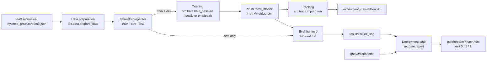

# MultiLabel_N24

A learning project that classifies N24News articles into their 24 news
sections with PyTorch and transformers. This baseline branch holds the frozen
legacy code, the guardrails added around it, and the pipeline that trains and
judges the baseline model: the first classifier that every later model is
compared against. Terms in this README follow the [glossary](GLOSSARY.md).

## How it fits together



| Stage | Command | Reads | Writes |
|---|---|---|---|
| Data preparation | `src.data.prepare_data` | `datasets/news/nytimes_{train,dev,test}.json` | `datasets/prepared/` |
| Training | `src.train.train_baseline`, or `src.train.modal_train` on a GPU | prepared train and dev splits | `<run>/best_model/`, `<run>/metrics.json` |
| Tracking | `src.track.import_run` | `metrics.json` or `metrics/<run>.json` | `experiment_runs/mlflow.db` |
| Eval harness | `src.eval.run` | `<run>/`, prepared test split | `results/<run>.json` |
| Deployment gate | `src.gate.report` | results file, `gate/criteria.toml` | `gate/reports/<run>.html`, exit code |

Every stage is a module run from the repository root with
`uv run python -m src.<package>.<module>`. Stages talk to each other only
through files on disk, so each one can be rerun, tested, and inspected alone.

One rule holds the design together: **the trainer never reads the test split.**
Training chooses its best epoch on the dev split. Only the eval harness reads
the test split, after training is finished, so models never score themselves.
The deployment gate then judges the harness's results file against criteria
committed before any test score existed.

## Setup

Run this once in each clone or worktree. It installs the locked environment,
the pinned Gitleaks binary, and the git hooks, then runs the CI check:

```bash
uv sync --locked --group lint
bash scripts/install-gitleaks.sh
bash scripts/setup-hooks.sh
bash bins/ci_tasks/perform_ci.sh
```

The N24News split files (`nytimes_train.json`, `nytimes_dev.json`,
`nytimes_test.json`) are not in the repository. Put them, or a link to the
folder that holds them, at `datasets/news/`. The `datasets/` folder is
git-ignored.

## Data preparation

`src/data/prepare_data.py` turns the three split files into the prepared
dataset that the trainer and the eval harness read.

```bash
uv run python -m src.data.prepare_data --input-dir datasets/news --output-dir datasets/prepared
# or, deleting any earlier datasets/prepared first:
bash bins/ci_tasks/data_prep.sh
```

- The sections are the sorted set of sections in the train split. There must
  be exactly 24, or preparation stops.
- A dev or test record whose section is missing from train, or any record with
  an empty abstract, stops preparation with the split and record index.
- Text cleaning only collapses whitespace. Accents, numbers, and punctuation
  stay, because the tokenizer handles them.
- Each row keeps `headline`, `abstract`, and `body`, plus a `label` column of
  type `ClassLabel` whose names are the sections. The section names travel
  with the data, so no later stage keeps its own copy of the mapping.
- The output is a Hugging Face `DatasetDict` saved with `save_to_disk`. The
  command prints row counts and per-section counts for each split.

The baseline model reads only the abstract, but the headline and body are kept
so later models can use them without preparing the data again
([ADR 0004](docs/adr/0004-baseline-model-reads-abstract-alone.md)).

## Training the baseline model

`src/train/train_baseline.py` fine-tunes `FacebookAI/roberta-base` for
sequence classification. The model input is the abstract alone.

```bash
uv run python -m src.train.train_baseline --data-dir datasets/prepared --output-dir experiment_runs/roberta-baseline
```

Use a GPU for the full run. How a run works:

1. It creates the output directory and refuses to continue if it already
   exists, so an earlier run is never overwritten.
2. It tokenizes the train and dev abstracts, truncated to `--max-length`
   tokens. Padding happens per batch in the data collator.
3. The Hugging Face `Trainer` trains with linear learning-rate decay, 6%
   warmup, weight decay 0.01, and bf16 when the GPU supports it. It scores the
   dev split after every epoch and keeps the epoch with the best macro F1.
4. It predicts the dev split once more with the best epoch to get F1 for each
   section, then saves the weights and tokenizer to `best_model/` and deletes
   the checkpoints.
5. It writes `metrics.json`.

| Flag | Default | Meaning |
|---|---|---|
| `--data-dir` | `datasets/prepared` | Prepared dataset |
| `--output-dir` | required | Run directory; must not exist |
| `--model` | `FacebookAI/roberta-base` | Pretrained model name |
| `--epochs` | `3` | Training epochs |
| `--lr` | `2e-5` | Peak learning rate |
| `--batch-size` | `32` | Train batch size; dev uses twice this |
| `--max-length` | `128` | Tokens kept per abstract |
| `--seed` | `42` | Random seed |
| `--max-steps` | `-1` | Stop after N steps for a smoke run |

`metrics.json` is the run's record. Tracking and the eval harness both read it:

- `dev_loss`, `dev_accuracy`, `dev_f1_macro`, and `dev_f1_per_section`
- `args`: every flag, as strings
- `git_commit`: the output of `git describe --always --dirty`, so a run from
  uncommitted code ends in `-dirty`
- `dataset_sha256`: a hash of every file in the prepared dataset except
  `state.json`, which the datasets library rewrites with a random fingerprint
  on each save
- `weights_sha256`: the hash of `best_model/model.safetensors`
- `log_history`: the trainer's loss and dev scores at each logging step and
  evaluation, which become the training curves

The recipe differs from the N24News paper's, which reports about 78% macro F1
from abstracts alone; see ADR 0004 before you change it.

**Smoke runs.** `--max-steps 5` stops after five steps, scoring and saving at
that step instead of at each epoch. `bash bins/ci_tasks/smoke_test.sh` does
this into `experiment_runs/smoke-1` to check that the trainer runs end to end.

## Training on Modal

`src/train/modal_train.py` runs the same `train` function on a Modal L4 GPU
with a two-hour timeout.

- The image installs the dependencies from `uv.lock` and has the
  `FacebookAI/roberta-base` weights and tokenizer built in, so a run does not
  download them again.
- The prepared dataset comes from the `n24-data` volume. Each run is written
  to `/news24-runs/<name>` on the `n24-runs` volume.
- The trainer flags are parsed on your machine before the GPU starts, so a
  typo fails right away. The git commit is also read locally, because the
  container has no git checkout.

One-time setup, from the repository root:

```bash
uv run modal setup
uv run modal volume create n24-data
uv run modal volume put n24-data datasets/prepared /prepared
```

A real experiment goes through `bins/ci_tasks/train_modal.sh`, which trains
and publishes the run in one step:

```bash
bash bins/ci_tasks/train_modal.sh roberta-lr3e-5 "--lr 3e-5"
```

It trains, copies the run's `metrics.json` to `metrics/<name>.json`, imports
that file into the local MLflow store, and stages it for you to commit. Smoke
runs use plain `modal run`, so `metrics/` holds only real experiments:

```bash
uv run modal run -m src.train.modal_train --name smoke-1 --args "--max-steps 5"
```

The script fetches only `metrics.json`. Download the whole run before you
score it with the eval harness:

```bash
uv run modal volume get n24-runs roberta-lr3e-5 runs_modal/
```

## Experiment tracking

`src/track/import_run.py` logs runs into a local MLflow store
([ADR 0006](docs/adr/0006-mlflow-imports-metrics-json.md)). Training never
talks to MLflow. The import reads a finished run's `metrics.json` and logs it
as one MLflow run in the `baseline-model` experiment, named after the run's
output directory:

- parameters: the trainer flags
- metrics: the `log_history` curves by step, the final dev scores, and
  per-section dev F1 as `dev_f1/<section>` (MLflow rejects `&`, so
  "Art & Design" becomes "Art and Design")
- tags: `git_commit`, `dataset_sha256`, `weights_sha256`

A run whose name is already in the store is skipped, so imports are safe to
repeat. The store `experiment_runs/mlflow.db` is a git-ignored cache; the
`metrics/*.json` files in git are the source of truth. Rebuild the store on
any clone, add a local run, and browse:

```bash
uv run python -m src.track.import_run metrics/*.json
uv run python -m src.track.import_run experiment_runs/smoke-1/metrics.json
uv run mlflow ui --backend-store-uri sqlite:///experiment_runs/mlflow.db
```

## Eval harness

`src/eval/run.py` scores one trained run on the test split and writes its
results file. It measures and does not judge.

```bash
uv run python -m src.eval.run --run-dir runs_modal/roberta-baseline
```

`--data-dir` defaults to `datasets/prepared` and `--results-dir` to `results`.

- It runs on CPU with `torch.use_deterministic_algorithms(True)` and tokenizes
  with the run's own `max_length` from `metrics.json`, so the input matches
  training.
- It predicts the test split twice, loading the model fresh each time. The
  number of sections that differ between the passes and the largest logit
  difference are the repeatability numbers.
- It recomputes the weights and prepared dataset hashes and records them next
  to the values in `metrics.json`. These are reproducibility evidence.
- It refuses to overwrite an existing results file.

The results file `results/<run>.json` holds the eval version, the test split
hash, the run name and directory, the git commit, both pairs of hashes, test
accuracy, test macro F1, per-section test F1, the repeatability numbers, the
predicted section for every test article, and the torch and transformers
versions.

`EVAL_VERSION` in `src/eval/run.py` is the eval version. Bump it whenever the
harness or the test split changes, then rerun the harness for every model,
the baseline model included. Results are only compared within one eval version
and test split ([ADR 0005](docs/adr/0005-eval-comparability.md)).

## Deployment gate

`src/gate/report.py` decides whether a scored run may be deployed. It reads a
results file and the criteria in `gate/criteria.toml`.

**Pre-register the criteria first.** Fill in `gate/criteria.toml` and commit it
before you score any model on the test split, so the git history proves the
thresholds came before the results. Pin the test split hash there:

```bash
uv run python -c "from pathlib import Path; from src.train.train_baseline import dataset_sha256; print(dataset_sha256(Path('datasets/prepared/test')))"
```

The criteria file holds `eval_version`, `test_split_sha256`, the
`[accuracy]` minimums, and the `[repeatability]` tolerance `logits_atol`.
Unknown keys or an unpinned hash are rejected. Then judge a run:

```bash
uv run python -m src.gate.report results/roberta-baseline.json
```

The deployment gate first refuses, with exit code 2, a results file whose eval
version or test split hash differs from the criteria. Otherwise it runs seven
checks; the run is deployable only if all of them pass.

| Group | Check | Fails if |
|---|---|---|
| Accuracy | Test macro F1 | below `min_test_f1_macro` |
| Accuracy | Test accuracy | below `min_test_accuracy` |
| Accuracy | Every section | the worst section's F1 is below `min_section_f1` |
| Repeatability | Two passes agree | any section differs, or any logit differs by more than `logits_atol` |
| Reproducibility | Weights | the recomputed weights hash differs from `metrics.json` |
| Reproducibility | Dataset | the recomputed prepared dataset hash differs from `metrics.json` |
| Reproducibility | Clean commit | no commit is recorded, or it ends in `-dirty` |

It prints the checks as a table and writes `gate/reports/<run>.html`, whose
rows link to their evidence: the results file or the run's `metrics.json`.
`--criteria` and `--reports-dir` override the default paths.

| Exit code | Meaning |
|---|---|
| 0 | Deployable |
| 1 | Not deployable: at least one check failed |
| 2 | Refused: other eval version or test split |

## Guardrails and CI

Guardrails are automated checks that block a commit, a push, or a CI run.
[CI and privacy checks](docs/ci-and-privacy.md) has the full details.

- **pre-commit** checks the commit identity, scans the staged files for
  privacy findings and secrets, and blocks staged files over 20,000 bytes.
- **commit-msg** scans the message for personal information.
- **pre-push** scans the history being pushed, then runs the CI check.
- **`bins/ci_tasks/perform_ci.sh`** runs on every push and pull request in
  GitHub Actions. It scans working, staged, and historical content for privacy
  findings and secrets, runs the hook regression tests, Ruff lint and format,
  Pyright, the offline tests, and a syntax check of every shell script. Every
  check runs even after a failure, and any failure fails the run. A change is
  done when this script passes.

Commits use the owner's GitHub noreply identity
([ADR 0003](docs/adr/0003-github-noreply-identity.md)), and `main` is updated
only by fast-forward merges from a local machine; see the merging section of
the CI document.

## Legacy code

The legacy code's behavior is frozen
([ADR 0001](docs/adr/0001-legacy-behavior-frozen.md)). It covers
`scripts/news-classifier.py`, `src/utils/data.py`,
`src/preprocess/roberta_preprocessor.py`, and the notebooks. Some of it does
not work: `news-classifier.py` expects an `n24news.csv` that does not exist,
and `load_datajson` reads an `article` key. That is the brownfield starting
point, and `tests/test_legacy.py` pins it. Changes to legacy code are limited
to formatting, imports, and annotations.

## Repository layout

```text
src/
  data/          data preparation
  train/         trainer and its Modal wrapper
  track/         MLflow import
  eval/          eval harness
  gate/          deployment gate and its HTML template
  preprocess/, utils/   legacy code
bins/ci_tasks/   shell entry points: CI, data preparation, smoke test, Modal training
scripts/         guardrail tooling, setup scripts, and the legacy news-classifier.py
gate/            criteria.toml, and reports/ written by the deployment gate
metrics/         metrics.json of each published Modal run
results/         results files written by the eval harness
tests/           offline unit tests
docs/            CI document and ADRs
notebooks/       exploration notebooks (legacy)
plans/           planning notes
datasets/        raw and prepared data (git-ignored)
experiment_runs/ local runs and the MLflow store (git-ignored)
runs_modal/      runs downloaded from Modal (git-ignored)
```

## Tests

The tests run offline on CPU and never download pretrained weights. Where a
model is needed they build a tiny RoBERTa on synthetic splits.

- `tests/test_baseline_model.py`: data preparation (sorted sections,
  whitespace cleaning, rejected records) and the trainer (metrics match
  scikit-learn; a smoke run writes `best_model/` and `metrics.json`).
- `tests/test_import_run.py`: the MLflow import logs scores, parameters, tags,
  and curves, and skips a run that is already in the store.
- `tests/test_deployment_gate.py`: the eval harness's results file,
  repeatability, and refusal to overwrite, and every pass, fail, and refusal
  path of the deployment gate.
- `tests/test_privacy.py`: the privacy scanner and the identity guard.
- `tests/test_legacy.py`: the current behavior of the legacy code.

```bash
HF_HUB_OFFLINE=1 HF_DATASETS_OFFLINE=1 uv run python -m unittest discover -s tests -v
```

## Decisions

- [ADR 0001: Legacy behavior is frozen](docs/adr/0001-legacy-behavior-frozen.md)
- [ADR 0002: History was rewritten before the baseline branch](docs/adr/0002-history-rewritten-before-baseline.md)
- [ADR 0003: Commits use the owner's GitHub noreply identity](docs/adr/0003-github-noreply-identity.md)
- [ADR 0004: The baseline model reads the abstract alone](docs/adr/0004-baseline-model-reads-abstract-alone.md)
- [ADR 0005: Results are compared only within one eval version and test split](docs/adr/0005-eval-comparability.md)
- [ADR 0006: MLflow is a local view imported from each run's metrics.json](docs/adr/0006-mlflow-imports-metrics-json.md)
- [Glossary](GLOSSARY.md)
