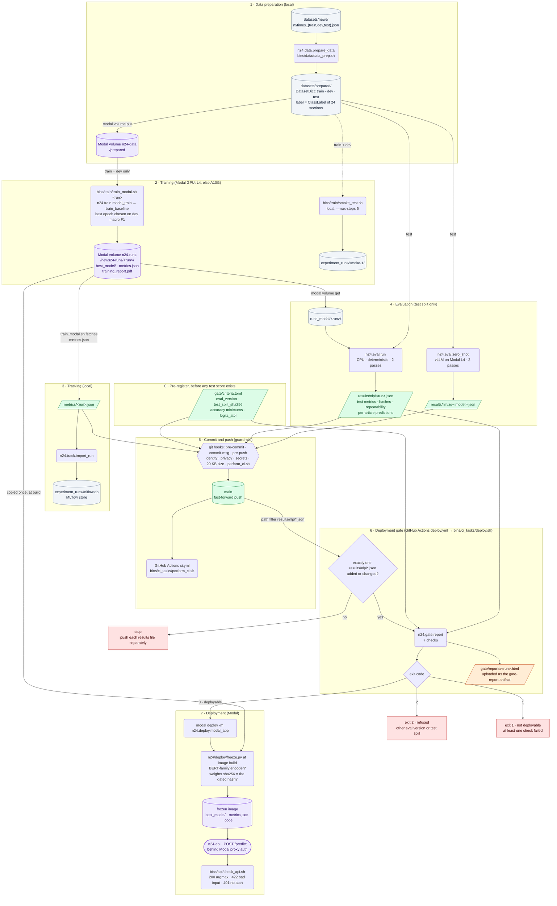
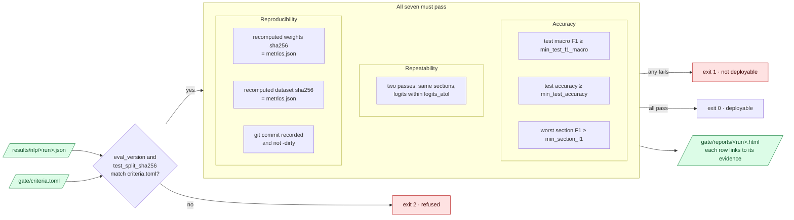

# System diagram

This page draws every command, artifact, and guardrail in the baseline
branch, from the raw N24News articles to a deployment. The
[README](../README.md) has the four-step overview and the commands. Terms
follow the [glossary](../GLOSSARY.md).

## From raw articles to a deployment

| Color | Where the artifact lives |
|---|---|
| Green | Committed to git. Git is the source of truth. |
| Gray | Local and git-ignored (`datasets/`, `experiment_runs/`, `runs_modal/`). Rerun the stage to rebuild it. |
| Purple | On Modal, as a volume, the frozen image, or the live app |
| Orange | A GitHub Actions artifact from the deploy run |
| Red | A stop. Nothing deploys. |

Parallelograms are files, cylinders are stores and directories, rounded boxes
are commands, and diamonds are decisions. The hexagon is the set of git hooks.

## The deployment gate runs seven checks

